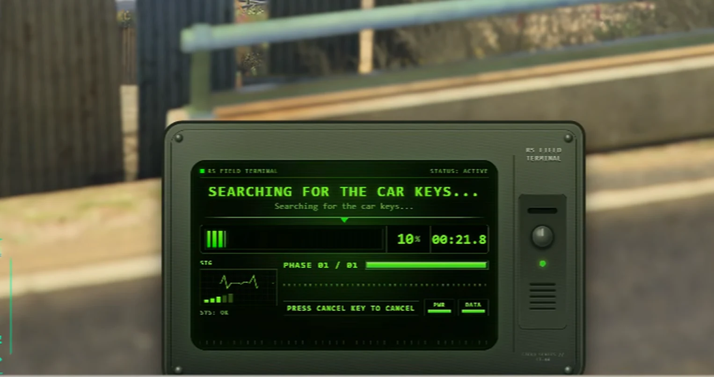
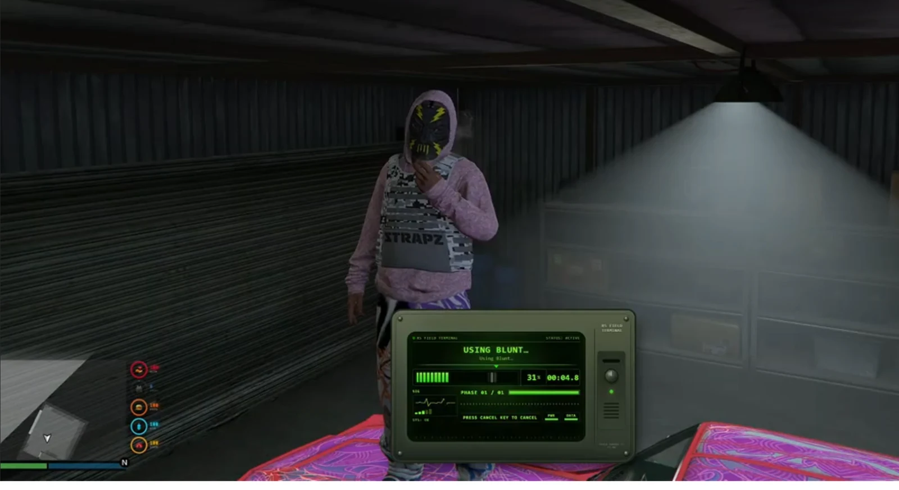
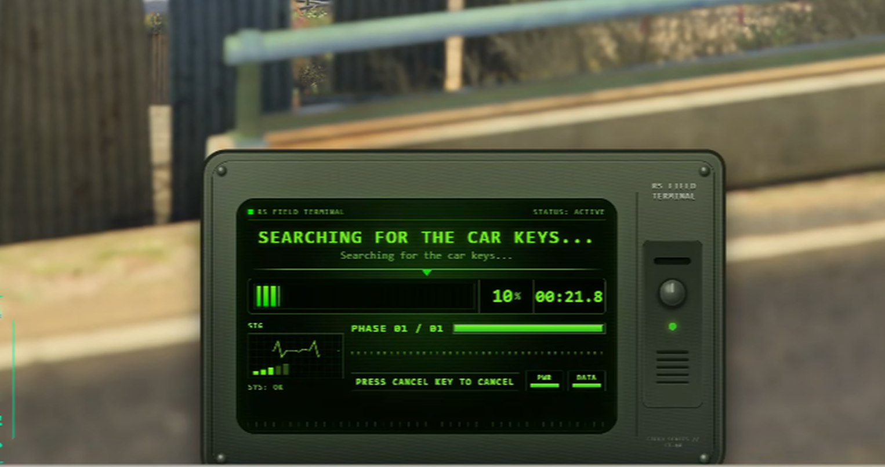

# RSGTA Modern Progressbar

<a href="https://reality-sucks-rp-webstore.tebex.io/package/7667590"></a>

Give everyday actions a modern field-terminal display. This framework-independent progress provider supports single and multi-stage actions, animations, scenarios, attached props and cancellation. Use its QBCore, Qbox, ESX or direct-export paths to fit your existing resources.

[Download the original ZIP](https://github.com/RealitySucksRP/rsgta-progressbar/releases/latest/download/progressbar.zip) | [Free on Tebex](https://reality-sucks-rp-webstore.tebex.io/package/7667590) | [Watch preview](https://www.youtube.com/watch?v=fnyxDDbBaKQ) | [Website](https://realitysucksrp.github.io/) | [Discord](https://discord.gg/e9V3rPHySx) | [YouTube](https://www.youtube.com/@RealitySucksRP) | [All free scripts](https://reality-sucks-rp-webstore.tebex.io/category/free-scripts)

**Install folder:** `progressbar`. Download the original ZIP to retain the package folder layout. Source, configuration, licenses and included assets are provided below.

<details>
<summary>More screenshots</summary>



</details>

## Package documentation

<p align="center">
  
</p>

# RSGTA Modern Progressbar v4.3.0

**Free • Full source • GPL-3.0-only • Legacy and Enhanced ready**

RSGTA Modern Progressbar is RealitySucksRP's universal field-terminal progress system for FiveM. The engine is **framework-agnostic**: one `progressbar` resource can serve Qbox, QBCore, ESX, ox-style callers, custom frameworks and standalone resources without requiring `rs_bridge` or an inventory dependency.

> **Important:** keep the extracted folder named exactly `progressbar`. Current QBCore checks the `progressbar` resource and routes its wrapper through `exports['progressbar']`; Qbox keeps QB-compatible callers working through the same resource name. ESX uses the separate `esx_progressbar` API name, which this resource satisfies through `provide 'esx_progressbar'` plus the expected exports.

## Compatibility

| Environment | Supported path |
| --- | --- |
| Qbox / `qbx_core` | QB-compatible `exports['progressbar']` callers and direct exports |
| QBCore / `qb-core` | Current `QBCore.Functions.Progressbar` → `exports['progressbar']:Progress(...)` |
| ESX / `es_extended` | `ESX.Progressbar` / `exports['esx_progressbar']:Progressbar(...)` |
| Ox-style resources | Direct `progressBar`, `progressCircle`, `progressActive`, `cancelProgress` exports |
| Standalone / custom | Direct `exports['progressbar']` API |
| Legacy / Enhanced | Same resource; no separate build required |

Qbox's QB compatibility layer lets QB-style resources continue using the familiar QBCore path. Resources hardcoded to `lib.progressBar()` still use ox_lib's own progress UI unless the **optional** ox_lib bridge in `tools/ox_lib` is intentionally installed.

## Why one build works across frameworks

The progressbar does not own jobs, money, inventory or framework state. It only owns progress presentation, animation/prop lifecycle, control disabling, cancellation and completion callbacks. That keeps framework-specific business logic in the calling resource and makes this resource portable.

## Features

- Modern field-terminal NUI
- Single-stage and multi-stage actions
- Lua-authoritative completion safety
- QBCore/Qbox compatible callbacks
- ESX compatibility alias
- Third-party `qb-progressbar` compatibility alias
- Ox-style direct exports
- Standalone direct API
- Animations, scenarios and sequential animation stages
- Up to five validated network props per action
- Player cancellation with configurable key mapping
- Control disabling
- Dead/ragdoll/swimming/cuffed/falling handling for ox-style semantics
- Completion ledger and watchdog recovery
- Resource-stop cleanup
- Server-side prop ownership/model validation
- Four built-in terminal themes
- `center-bottom`, `center`, and `center-top` placement
- Built-in `/rsprogressdiag` installation diagnostic

## Installation

1. Stop/remove the progressbar resource you are replacing.
2. Extract this package so the folder is exactly `progressbar`.
3. Ensure it **before resources that call its exports**.
4. Do not run two progress providers for the same API at the same time.
5. Fully restart the server after replacing an existing provider.
6. Run `/rsprogressdiag` in client F8 and confirm the detected environment.

### Qbox

```cfg
ensure ox_lib
ensure qbx_core
ensure progressbar
# resources that use progress after this
```

No Qbox edits are required for QB-compatible callers. If a resource calls `lib.progressBar()` directly, it continues to use ox_lib unless you deliberately install the optional adapter under `tools/ox_lib`.

### QBCore

```cfg
ensure qb-core
ensure progressbar
# resources that use QBCore.Functions.Progressbar after this
```

No edits to `qb-core` are required. Current QBCore's wrapper calls the `progressbar` export this resource implements.

### ESX

```cfg
ensure es_extended
ensure progressbar
# ESX resources after this
```

Do not also start a separate `esx_progressbar`. This resource declares `provide 'esx_progressbar'` and exposes the expected `Progressbar` and `CancelProgressbar` exports.

### Standalone / custom framework

```cfg
ensure progressbar
```

Then call the direct exports shown below.

## QBCore-compatible example

```lua
exports['progressbar']:Progress({
    name = 'repair_vehicle',
    label = 'Repairing Vehicle',
    duration = 5000,
    useWhileDead = false,
    canCancel = true,
    controlDisables = {
        disableMovement = true,
        disableCombat = true,
    },
}, function(cancelled)
    if cancelled then return end
    print('Repair complete')
end)
```

## ESX example

```lua
ESX.Progressbar('Repairing Vehicle', 5000, {
    FreezePlayer = true,
    onFinish = function()
        print('Repair complete')
    end,
    onCancel = function()
        print('Repair cancelled')
    end,
})
```

## Direct / custom-framework example

```lua
local started = exports['progressbar']:Start({
    label = 'Searching Vehicle',
    duration = 5000,
    canCancel = true,
}, function(cancelled)
    print('cancelled:', cancelled)
end)
```

## Multi-stage example

```lua
exports['progressbar']:Progress({
    label = 'Inspecting Vehicle',
    canCancel = true,
    stages = {
        { message = 'Checking exterior', duration = 1500 },
        { message = 'Scanning electrical system', duration = 2500 },
        { message = 'Finishing inspection', duration = 1500 },
    },
}, function(cancelled)
    print('cancelled:', cancelled)
end)
```

## Diagnostics

Run in client F8:

```text
rsprogressdiag
```

The diagnostic reports the package version, resource folder, detected Qbox/QBCore/ESX/Standalone environment, ox_lib state, NUI readiness, active state and obvious duplicate progress providers.

For QBCore/Qbox wrapper testing, temporarily set `Config.devMode = true` and run:

```text
rsfieldqbtest
```

Turn dev mode back off afterward.

## Server-owner notes

- **Folder name matters:** use `progressbar`, not `progressbar(1)` or `rsgta-progressbar` on the server.
- **One provider only:** do not leave the stock QBCore progressbar, a separate ESX progressbar and this resource running together.
- **No inventory dependency:** ox_inventory, qb-inventory and other inventories do not need modification for this resource.
- **No external RS Bridge dependency:** this progressbar is self-contained.
- **Qbox note:** QB-compatible callers route here; hardcoded `lib.progressBar()` is still an ox_lib call unless you intentionally install the optional adapter.
- **Full restart recommended:** especially after replacing another provider with the same resource/export name.
- **Live smoke test:** test complete, cancel, non-cancellable, animation, prop and framework-wrapper actions before opening the server to players.
- **Enhanced artifact note:** current FiveM Enhanced builds include the August 2026 fix for `provide`/`GetResourceState`. If ESX reports `esx_progressbar` as missing despite this resource being installed, update the server artifact first.

See [`INSTALL.md`](INSTALL.md) for a longer installation checklist and [`DEVELOPER-API.md`](DEVELOPER-API.md) for the complete API.

## License

This is a **GPL-3.0-only** full-source release because it is derived in part from `swkeep/keep-progressbar`. See `LICENSE.md`, `COPYING`, and `THIRD_PARTY_NOTICES.md`.

The GPL license allows use, modification and redistribution under its terms. This package is free and is not distributed under RealitySucksRP's restrictive paid-resource license.

## Upstream/API references

- QBCore progressbar: https://github.com/qbcore-fivem/progressbar
- QBCore client wrapper: https://github.com/qbcore-framework/qb-core/blob/main/client/functions.lua
- Qbox compatibility documentation: https://docs.qbox.re/faq
- ESX progressbar integration: https://github.com/esx-framework/esx_core
- Cfx resource manifests: https://docs.fivem.net/docs/scripting-reference/resource-manifest/
- Cfx NUI callbacks: https://docs.fivem.net/docs/scripting-manual/nui-development/nui-callbacks/


[Earlier repository documentation and all existing links](PREVIOUS_README.md)
